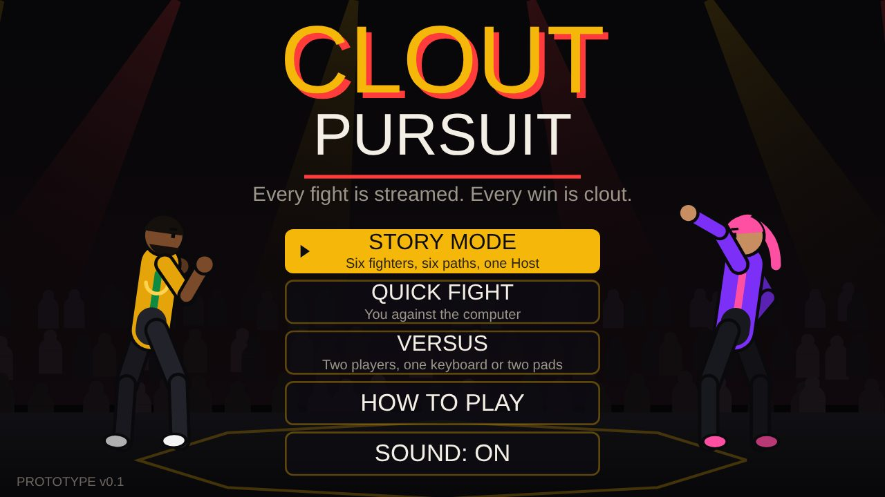
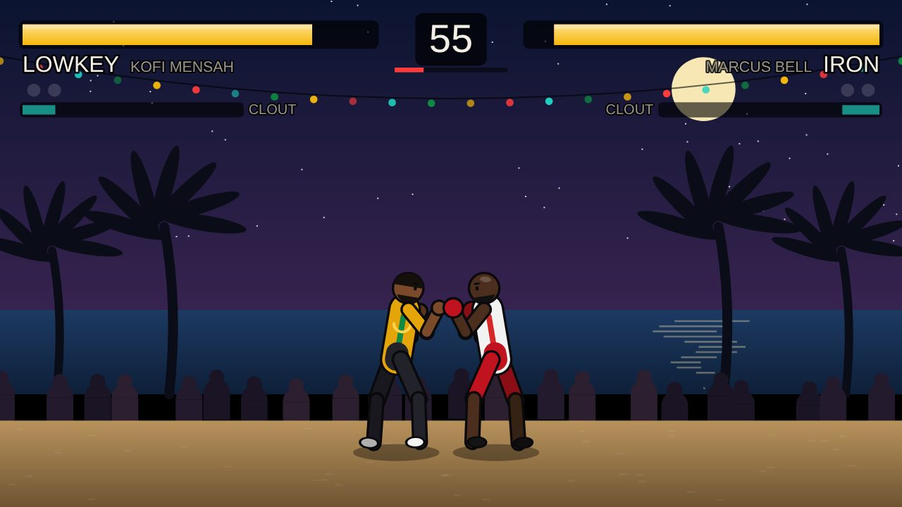
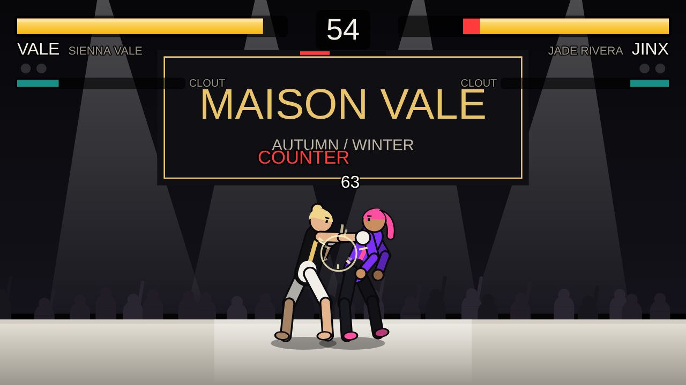
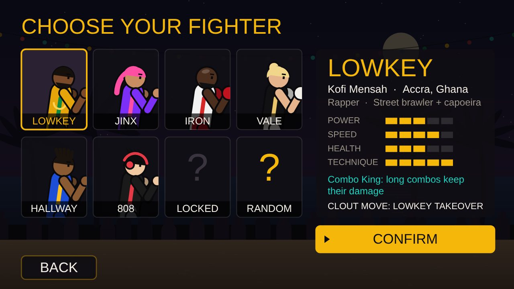
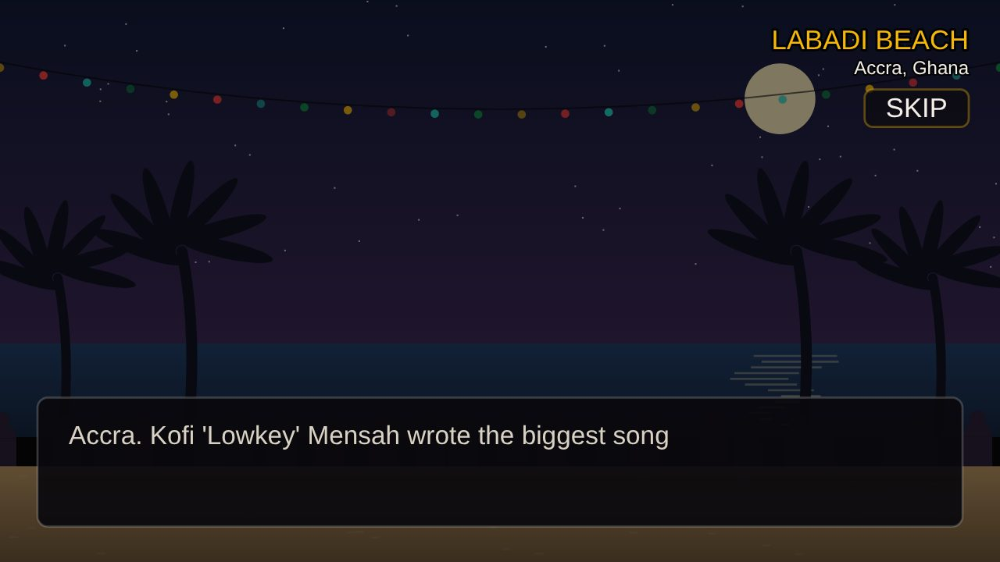

# Clout Pursuit

**Every fight is streamed. Every win is clout.**

Clout Pursuit is a story-driven fighting game built around an invite-only, livestreamed fight league called The Circuit, run by a masked promoter known as The Host. Rappers, streamers, boxers, models, wrestlers and producers fight for money, fame and freedom. Every character is original.

This repository holds **prototype v0.1.0**: a playable 2D vertical slice that runs in a web browser and as an Android test app. It is used to test the combat, roster and story structure before full production in Unreal Engine 5.



| | |
| --- | --- |
|  |  |
|  |  |

## What's in the prototype

- **6 playable fighters** plus an unlockable boss, each with their own stats, perk and Clout move:

  | Fighter | Who they are | Style |
  | --- | --- | --- |
  | Kofi "Lowkey" Mensah | Rapper from Accra fighting to buy back his masters | Street brawler + capoeira |
  | Jade "Jinx" Rivera | Streamer rebuilding her name after a rigged-fight scandal | Wild, crowd-driven |
  | Marcus "Iron" Bell | Ex-heavyweight contender, wrongly convicted | Pure boxing |
  | Sienna Vale | Model escaping a controlling manager | Muay Thai |
  | Dre "Hallway" Thompson | High-school wrestler paying his mom's rent | Amateur wrestling |
  | Yuki "808" Tanaka | Producer who runs Tokyo's underground fights | Karate + jiu-jitsu |
  | The Host (unlockable) | Owner of The Circuit | Everything |

- **Story mode:** one path per fighter, 5 fights each, a mid-story choice (take The Host's deal or stay clean) that changes the remaining fights and the ending.
- **8 locations:** Labadi Beach (Accra), Ironwood State Pen, Westside High gym (Atlanta), Maison Vale runway (London), The Stream Room (LA), Victoria Island rooftop (Lagos), Shibuya Underground (Tokyo), and The Host's Arena.
- **Modes:** Story, Quick Fight (vs computer, 3 difficulties), Versus (2 players).
- **Combat:** punch, kick, heavy, throw, block, jump attacks, combo chains (punch > kick > heavy > Clout move), counter hits, knockdowns, the Clout meter and a Hype taunt.
- **Controls:** keyboard, gamepad (Xbox/PlayStation layout) and touch screen.
- **Synthesized sound and music**, no external assets.

## Play it

**In a browser:** open `index.html`. On a phone, turn it sideways.

**On Android:** build the APK (below) or download it from the Releases page, then install it. Android will warn that the app is from an unknown developer because it is signed with a test key.

### Controls

| Action | Keyboard | Controller | Touch |
| --- | --- | --- | --- |
| Move | A / D or arrows | Stick or D-pad | Left stick |
| Jump | W | Up | Stick up |
| Block | S or hold back | Down, LT or hold back | Stick down |
| Punch / Kick / Heavy | J / K / L | X / A / Y (□ / ✕ / △) | Buttons |
| Throw | U | B (○) | THROW |
| Clout move (meter full) | I | RB (R1) | CLOUT |
| Hype taunt | O | LB (L1) | HYPE |
| Pause | Esc | Start / Options | Top centre |

Player 2 in Versus: arrows to move, N M , . / ; for attacks, or a second controller.

## Project layout

```
game.html              Game source: a single HTML5 canvas file, no dependencies
index.html             Full HTML page built from game.html (used in the APK)
build_index.py         Builds index.html from game.html
android/build_apk.py   Builds a signed Android APK without the Android SDK
android/verify_apk.py  Checks the APK: zip alignment, v2 signature, manifest, resources, bytecode
docs/screenshots/      Screenshots used in this README
```

## Build the Android APK

Requires Python 3 with `cryptography` and `Pillow` (`pip install cryptography pillow`).

```bash
python3 build_index.py
python3 android/build_apk.py index.html dist/CloutPursuit-v0.1.0-test.apk
python3 android/verify_apk.py dist/CloutPursuit-v0.1.0-test.apk
```

The first build creates a test signing key in `android/keys/`. **That folder is ignored by git and must never be committed.** Keep a backup of it: Android only installs updates signed with the same key. Use a separate, properly stored release key for Google Play.

App details: package `com.cloutpursuit.game`, version 0.1.0, Android 7.0 (API 24) and up, target API 34, landscape full screen. The game works offline; the INTERNET permission is only used to load web fonts.

## Known limits of v0.1

- 2D stick-style fighters drawn in code, not the final art style
- No online play; single player is against the computer
- The Android build is a WebView wrapper signed with a test key
- Not tested on physical Android devices yet

## Roadmap

Next is a vertical slice in **Unreal Engine 5**: two fully modelled fighters, one arena, motion-captured animation and rollback online play, as the basis for pitching to publishers and the PlayStation, Xbox and Steam developer programmes. Target platforms: PS5, Xbox Series X|S and PC.

## Ownership

© 2026 MEdge Studios LLC. All rights reserved. No license is granted to copy, modify or distribute this code or its characters, story and artwork.
